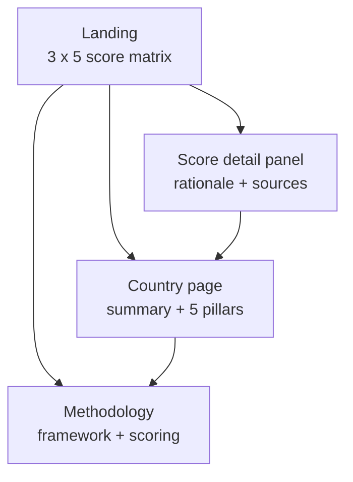
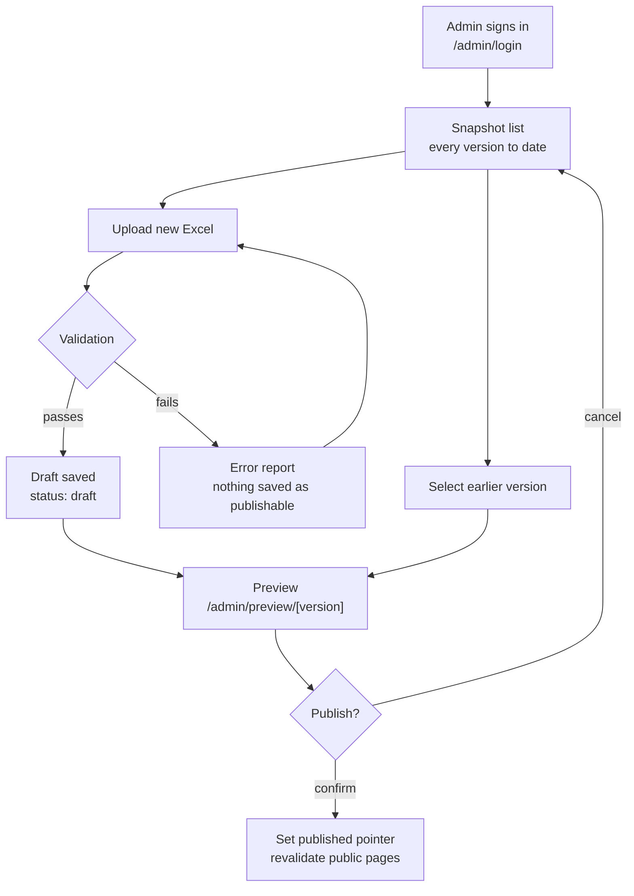
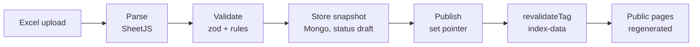

# FLOW

Every flow in the system. Read `CONTEXT.md` first.

---

## 1. Public navigation

Four surfaces. The three data surfaces are three cuts of the same 15 records;
methodology is static content from the `meta` tab.

### Landing — `/`

- Header: index name, `as of {month year}`, nav.
- Intro: two or three sentences from `meta.intro`.
- **The matrix.** Countries as rows, five pillars as columns. Each cell shows
  the numeral, a band colour, and a text band label. Composite score column at
  the right if `meta.show_composite` is true.
- Legend explaining the bands.
- Clicking a cell opens the score detail panel. Clicking a country name goes to
  that country's page.

Must degrade to a readable stacked layout on narrow viewports. A five-column
table does not work at 320px — switch to one card per country with its five
pillars listed.

### Score detail panel

A slide-over drawer, not a page. The matrix stays visible behind it.

- Country name, pillar name.
- Score with its band label and the scale for context.
- Rationale paragraph.
- Reference list: title, publisher, date, outbound link.
- Previous / next controls to move across that country's pillars without
  closing the drawer.
- Link through to the full country page.

**The drawer must be deep-linkable.** Opening it pushes `?country={id}&pillar={id}`
to the URL; loading that URL opens the drawer directly. The client will share
links to individual scores constantly. Closing it restores the clean URL.

Trap focus while open, close on `Escape`, restore focus to the originating cell.

### Country page — `/country/[slug]`

- Header: country name, composite score, `as of` date.
- Narrative summary from the `countries` tab.
- A radar chart across the five pillars. This is the visual anchor of the page.
  Provide a data table alternative for screen readers.
- Five pillar blocks, each expandable: score, rationale, references.
- Footer links to the other two countries.

### Methodology — `/methodology`

Static long-form content from the `meta` tab: what the index measures, the five
pillars defined, the scoring scale, how scores are assigned, weighting, data
sources and cut-off date, assumptions and limitations, update cadence, and the
disclaimer block.

Content lives in the spreadsheet, not in the codebase, so the client can revise
it without a deploy.

---

## 2. Admin flow

### Snapshot list — `/admin`

The landing screen after sign-in. A table of every snapshot ever created, newest
first:

| Column | Notes |
|---|---|
| Version | Monotonic integer, never reused |
| Period | The `as_of` value, e.g. `2026-09` |
| Status | `published` / `draft` / `archived` |
| Uploaded | Timestamp and the name of the source file |
| By | Who uploaded it |
| Validation | Passed, or passed with N warnings |
| Actions | Preview, Publish, Download source file (from blob storage) |

Exactly one snapshot has status `published` at any moment. Mark it clearly.

Empty state: "No data uploaded yet. Upload the first monthly file to get
started." with the upload action inline.

### Upload — `/admin/upload`

1. Admin selects an `.xlsx` file.
2. Server writes the file to Azure Blob Storage, then parses and validates it
   (rules in `DATA_MODEL.md`). The file is stored either way — accepted uploads
   under `snapshots/`, rejected ones under `rejected/`.
3. **On failure:** show every error, each naming the tab, row, and column, plus
   what is wrong and what a valid value looks like. Nothing is saved as
   publishable. The live site is untouched.
4. **On success:** save as a draft snapshot pointing at the stored blob, and
   show the validation report — warnings, plus a **diff against the currently
   published snapshot**.

The diff is the most important thing on this screen. Nobody re-reads fifteen
rationales every month, but everyone reads:

> 3 scores changed · 2 rationales edited · 1 source added · 1 dead link

Show changed scores as `before → after`. Show edited rationale as a text diff.

### Preview — `/admin/preview/[version]`

The full public site rendered from any chosen snapshot, published or not.
Admin-only, never cached, never reachable without a session. A banner across the
top states which version is being previewed and that it is not live.

### Publish

Sets the chosen snapshot as the published pointer and triggers revalidation of
the public pages.

Requires a confirmation step that shows the diff against what is currently live.
Two distinct actions, deliberately styled differently:

- **Preview** — admin-only, public site unchanged. Safe, use freely.
- **Publish** — changes what the world sees. Confirmation required.

---

## 3. Data pipeline

`revalidateTag('index-data')` is the "trigger render" step. There is no CDN
purge to manage and no separate build hook — Next.js regenerates the cached
pages and pushes them to the edge.

Expect the public site to reflect a publish within seconds.

---

## 4. Rollback

Rollback is publishing an earlier version. It is not a special code path.

1. Admin opens the snapshot list, finds the last good version.
2. Previews it to confirm.
3. Publishes it. The current snapshot moves to `archived`, the chosen one
   becomes `published`, public pages revalidate.

Because a snapshot is one complete document, there is no way to end up with
scores from one month against references from another.

Rollback is itself reversible — nothing is deleted, ever.

---

## 5. Failure paths

Handle each of these explicitly. Silent failure is the worst outcome for this
project.

| Failure | Behaviour |
|---|---|
| Validation fails | Detailed per-row error report. Nothing published. Live site untouched. |
| File is not a valid `.xlsx` | Reject at upload with a clear message before parsing. |
| File exceeds size limit | Reject with the limit stated, not a 500. |
| A reference URL returns non-200 | **Warning**, not an error. Publishing is allowed; the warning is shown in the report and recorded on the snapshot. Link rot over a year is normal and must not block a publish. |
| Blob storage unreachable during upload | Upload fails before anything is written to Mongo. Admin sees an error and retries. No orphaned snapshot. |
| Blob missing when downloading a source file | Admin sees "The source file for this version is no longer available". The snapshot itself still renders and publishes normally — a lost file must not break the data. |
| Mongo unreachable during publish | Publish fails loudly, admin sees an error, live site keeps serving the previous snapshot from cache. |
| Mongo unreachable during revalidation | Stale cached pages continue to serve. Do not render an error page to the public. |
| No snapshot published yet | Public pages show a neutral "This index has not been published yet" state. Never a stack trace, never an empty matrix. |
| Session expires mid-upload | Redirect to login, preserve the intended destination. |

---

## 6. What a normal month looks like

The whole point of the design, end to end:

1. Analyst edits the maintained Excel file.
2. Signs in at `/admin`.
3. Uploads the file. Validation passes with one dead-link warning.
4. Reads the diff: two scores changed, one rationale rewritten.
5. Opens the preview, checks the two changed cells.
6. Clicks Publish, confirms.
7. Public site reflects the new data within seconds.

Elapsed time: about three minutes. Twelve times a year.
